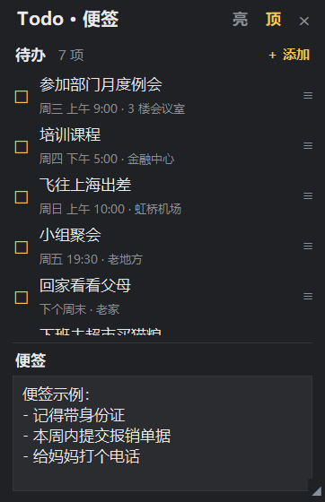
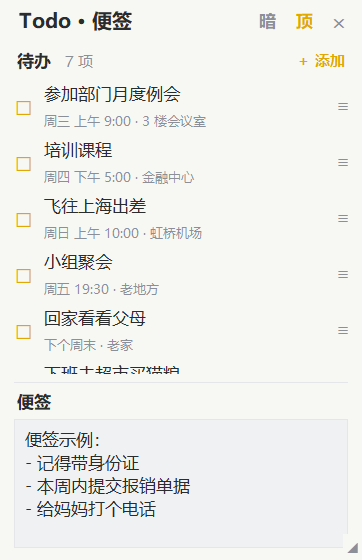
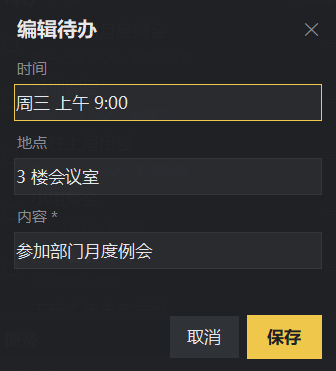

# Todo · 便签

一个放在 Windows 桌面上的**便笺风**小工具：左边记待办，右边随手写便签。**无边框、半透明、可拖动/缩放/置顶**，支持浅黑 / 浅白两套主题，完全离线，数据存在本机。

 

## 功能

- 🗒 **便笺式外观**：无系统标题栏、半透明背景、圆角观感，安静地待在桌面上
- 🎨 **浅黑 / 浅白一键切换**：点标题栏「亮/暗」切换主题
- 📌 **可拖动、可缩放、可置顶**：拖动标题栏移动，右下角 ◢ 缩放，点「顶」钉在最前
- ✅ **待办三栏填写**：每条待办分开填写「时间 / 地点 / 内容」
- ↕️ **手动排序**：拖动每行右侧的 `≡` 手柄即可调整顺序；也可右键「上移 / 下移」
- 🖊 **便签区**：下方一块文本区，随手记一段话，**自动保存**
- ⚙️ **状态记忆**：自动记住窗口位置、大小、主题、是否置顶
- 🔒 **完全离线**：SQLite 本地存储，无账号、无网络请求
- ⌨️ **全局唤出**：任何时候按 `Ctrl + Shift + 空格`，把窗口调到最前
- 🫥 **隐藏到后台**：点右上角 `✕` 隐藏，热键随时唤出；右键标题栏可退出
- 🖼 **专属图标 + 开机自启**：扁平便签风图标，已加入开始菜单与开机启动

## 界面

| 编辑待办 | 浅色主题 |
| --- | --- |
|  |  |

## 快速开始

### 方式一：直接运行 exe（推荐，无需 Python）

- **文件夹版（推荐）**：双击 `release\TodoApp\TodoApp.exe`（需保留同目录的 `_internal` 文件夹，不要只单独拷走 exe）。
- 也可双击项目根目录的 **`启动Todo.lnk`**，或在开始菜单搜索「Todo 便签」打开。
- 便携分发：`release\TodoApp-portable.zip`（解压后运行里面的 `TodoApp\TodoApp.exe`）。
- 不提供单文件版：单文件版启动时会把自身解压到系统临时目录，在受限/沙箱环境会报 `Could not create temporary directory!`。如确有需要，可自行执行 `.\build.ps1 -OneFile` 生成（能否运行取决于目标机器临时目录是否可写）。

### 方式二：用 Python 运行

```powershell
cd "D:\Agent Project\TODO"
python app.py
```

### 方式三：无控制台双击

双击 `TodoApp.pyw`。

## 使用说明

| 操作 | 方式 |
| --- | --- |
| 添加待办 | 待办区右上「＋ 添加」或 `Ctrl+N` |
| 编辑待办 | 双击某条待办；或右键「编辑」 |
| 勾选完成 | 点左侧 ☐ / ☑ |
| 调整顺序 | 拖动右侧 `≡` 手柄；或右键「上移 / 下移」 |
| 删除待办 | 右键「删除」（会二次确认） |
| 移动窗口 | 拖动标题栏 |
| 调整大小 | 拖右下角 ◢ |
| 置顶开关 | 标题栏「顶」（高亮表示已置顶） |
| 切换主题 | 标题栏「亮 / 暗」 |
| 写便签 | 在下方「便签」文本框输入，停止输入约 0.7 秒自动保存 |
| **随时唤出** | **按 `Ctrl + Shift + 空格`**（全局生效，隐藏也能唤出） |
| 隐藏到后台 | 点右上角 `✕`（之后用热键再唤出） |
| 退出程序 | 右键标题栏 →「退出程序」 |

## 开机自启与「开始菜单」图标

- **开机自启**：已创建启动项（`启动` 文件夹里的「Todo 便签」快捷方式，登录时以 `--hidden` 静默启动，按 `Ctrl+Shift+空格` 唤出）。
- **开始菜单图标**：已创建开始菜单快捷方式，可在开始菜单搜索「Todo 便签」。
- **固定到开始屏幕**：Windows 不允许程序自动固定，请在开始菜单搜索到「Todo 便签」后 **右键 →「固定到开始屏幕」**（一次即可）。
- 取消开机自启：删除 `%APPDATA%\Microsoft\Windows\Start Menu\Programs\Startup\Todo 便签.lnk`。

## 数据与隐私

- 数据库：`%APPDATA%\TodoApp\todo.db`（SQLite，含 `todos` 与 `note` 两张表）
- 偏好设置：`%APPDATA%\TodoApp\settings.json`（窗口位置/大小、主题、置顶）
- 备份：复制 `%APPDATA%\TodoApp` 文件夹即可；若该目录不可写会自动回退到程序目录下 `data\`。

## 项目结构

```
TODO/
├─ app.py                    # 入口（含 DPI 适配）
├─ TodoApp.pyw               # 无控制台双击入口
├─ todo/
│  ├─ models.py              # Todo / Note 数据类
│  ├─ storage.py             # SQLite 仓储（todos 排序、note）
│  ├─ service.py             # 业务逻辑（校验/排序/移动/便签）
│  ├─ hotkey.py              # 全局快捷键（Ctrl+Shift+空格）
│  └─ ui/
│     ├─ theme.py            # 浅黑/浅白两套主题
│     ├─ widgets.py          # 可滚动容器、窗口拖动等
│     ├─ main_window.py      # 便笺主窗口
│     └─ todo_dialog.py      # 添加/编辑待办浮动框
├─ tests/test_service.py     # 单元测试
├─ scripts/                  # 冒烟测试 / 演示数据 / 离线取 wheel
├─ build.ps1                 # 打包脚本
├─ requirements-build.txt    # 仅打包依赖（PyInstaller）
├─ assets/                   # 应用图标（app.ico / app.png）
├─ docs/                     # 截图
├─ 启动Todo.lnk              # 指向 release\TodoApp\TodoApp.exe 的快捷方式
└─ release/                  # 文件夹版产物
   ├─ TodoApp/TodoApp.exe    # 主程序（需与 _internal 同目录）
   └─ TodoApp-portable.zip   # 便携压缩包
```

## 开发与测试

运行应用本身**不需要任何第三方库**（仅 Python 标准库 + 自带 tkinter）。

```powershell
cd "D:\Agent Project\TODO"
python -m unittest discover -s tests -v   # 单元测试（15 项）
python scripts\smoke_ui.py                # 无值守 UI 冒烟测试
```

## 打包为 exe

```powershell
cd "D:\Agent Project\TODO"
.\build.ps1             # 默认文件夹版 -> release\TodoApp\TodoApp.exe（推荐）
.\build.ps1 -OneFile    # 可选单文件版 -> release\TodoApp.exe（受限环境可能无法启动）
```

## 常见问题

- **报 `Could not create temporary directory!` 或 `VCRUNTIME140.dll ... Permission denied`**：这是**单文件版**解压到系统临时目录失败，请改用文件夹版 `release\TodoApp\TodoApp.exe`（不要使用已废弃的单文件 exe）。
- **SmartScreen 提示「发布者未知 / 无法访问 SmartScreen」**：exe 未做代码签名，属正常现象。请**直接从文件夹双击** `release\TodoApp\TodoApp.exe`（不要从未知来源的下载副本运行）；若仍提示，点「更多信息 → 仍要运行」。
- **提示缺少文件**：文件夹版必须连同同目录的 `_internal` 文件夹一起复制或压缩。
- **窗口跑到屏幕外**：删除 `%APPDATA%\TodoApp\settings.json` 后重启即可恢复默认位置。
- **高分屏模糊**：程序启动时已开启 DPI 感知；若仍异常，可在系统兼容性里调整缩放。

## 仓库

- GitHub：<https://github.com/munk-alt/todo-goal.git>

## 版本

- v2.1.0 —— 新增扁平便签图标、开始菜单快捷方式、开机自启（静默）、全局快捷键 `Ctrl+Shift+空格` 唤出、`✕` 隐藏到后台、单实例唤醒。
- v2.0.1 —— 修复打包：改用文件夹版（避免单文件版在受限环境无法创建临时目录而打不开）。
- v2.0.0 —— 改为便笺风：无边框半透明窗口、浅黑/浅白主题、待办（时间/地点/内容）与便签分栏、拖拽排序、自动保存。
- v1.0.0 —— 初版窗口化表格应用。
